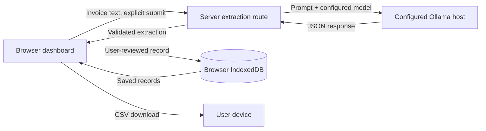

# InvoicePilot

Turn messy invoices into a reviewable expense ledger, with open-weight AI and a privacy-first local processing option.

InvoicePilot is a local-first MVP for freelancers, independent consultants, small-business owners, and small agencies. Paste invoice or receipt text, extract suggested fields with Ollama, review and correct every field, save expenses in your browser, and export the saved ledger as CSV.

> InvoicePilot is a productivity tool, not accounting, bookkeeping, tax, or compliance advice. Check extracted details against the original document.

## Product

- Live extraction and expense-category suggestions from your configured Ollama model. Sample text is sent to the model only when submitted and is never automatically saved.
- A review form for correcting vendor, reference, date, ISO currency, amounts, category, description, and model reasoning before saving.
- Five clearly marked fictional sample invoices covering freelance web development, graphic design, software, office supplies, and consulting. Loading or extracting a sample does not save it; saving always requires the user's approval.
- An explicit offline demo-fixture action for sample invoices. Demo values are pre-authored test data, clearly distinguished from live AI output, and are never silently substituted when model inference fails.
- IndexedDB persistence, vendor/reference search, category filtering, explicit delete confirmation, and CSV export of the actual saved records.
- Totals displayed separately for each currency. Incomplete fields stay missing; subtotal/tax/total inconsistencies receive a warning and are never auto-corrected.
- Responsive dashboard with model status, connection errors, confidence indicators, and local-storage disclosure.

### Screenshots

Add current desktop and mobile screenshots here when available, for example `docs/screenshots/dashboard.png` and `docs/screenshots/mobile.png`.

## Architecture



The UI has no direct model connection and never receives Ollama credentials or server environment variables. The shared extraction handler validates requests and model output using Zod-backed schemas. Vite serves the handler during local development; the production Node server serves the built frontend and the same handler from `/api/extract`. Production live extraction additionally requires an operator-configured bearer token, and all reviewed expenses are revalidated and stored only by the browser.

## Stack

- Vite 7, React 19, and TypeScript.
- Tailwind CSS 3 tooling with a small, custom CSS design system.
- Zod 3 for request and extraction validation.
- Ollama chat API for configurable local or explicitly configured remote inference.
- IndexedDB for browser-local persistence.
- A small CSV serializer with RFC-style quoting for commas, quotes, and line breaks.
- Vitest and fake-indexeddb for behavior-focused tests.

## Model

The default is **`gemma3:4b`**, selected as a practical instruct-capable open-weight model for local extraction on a reasonably capable laptop. It is the model sent in the Ollama request by default; configure `OLLAMA_MODEL` to select another compatible model. The dashboard displays the model returned by Ollama, not a hardcoded claim. Inference failures are shown, not replaced with fixture data.

Gemma 3 weights are distributed under Google's **Gemma Terms of Use**, not the Apache 2.0 license. Review the current [Gemma Terms of Use](https://ai.google.dev/gemma/terms) and [prohibited-use policy](https://ai.google.dev/gemma/prohibited_use_policy) before downloading or deploying. The terms include use restrictions, redistribution conditions, and obligations that may apply to products using Gemma. This repository does not redistribute model weights. Ollama distributes model packages separately; consult the selected model's Ollama library page and linked terms as well.

## Local setup

Requirements: Node.js 20.19 or newer in the 20.x line, npm 10, and [Ollama](https://ollama.com/download) for local live extraction.

1. Install JavaScript dependencies:

   ```sh
   npm ci
   ```

2. Start Ollama and download the configured model:

   ```sh
   ollama serve
   ollama pull gemma3:4b
   ollama run gemma3:4b
   ```

   `ollama run` opens an interactive prompt; exit it when the model download is complete. Ollama must remain running while InvoicePilot extracts invoices. On systems where the Ollama desktop application starts the service automatically, `ollama serve` may report that port 11434 is already in use; keep the existing service.

3. Configure the optional server environment. Defaults are `http://127.0.0.1:11434` and `gemma3:4b`:

   ```sh
   cp .env.example .env.local
   ```

   ```dotenv
   OLLAMA_BASE_URL=http://127.0.0.1:11434
   OLLAMA_MODEL=gemma3:4b
   # OLLAMA_API_KEY=   # Optional bearer credential for a trusted Ollama-compatible gateway
   ```

   Restart Vite after changing `.env.local`. Keep this file server-side; do not expose these values through client-side environment variables or commit credentials. For a remote Ollama host, use an explicit trusted HTTPS endpoint or a private network and understand that invoice text will be transmitted to that host. Do not expose an unauthenticated Ollama service to the public internet.

4. Run the app and open [http://localhost:3000](http://localhost:3000):

   ```sh
   npm run dev
   ```

   Paste 20 or more characters or load a clearly labelled example, submit it, review the live model result, and save. Confirm the Ollama model is answering with `ollama list` and `ollama run gemma3:4b`; the app header also shows the configured model and processing host. If Ollama is unavailable, follow the actionable message in the app and retry.

### Configuration

| Variable | Default | Purpose |
| --- | --- | --- |
| `OLLAMA_BASE_URL` | `http://127.0.0.1:11434` | Server-side Ollama API base URL. |
| `OLLAMA_MODEL` | `gemma3:4b` | Model tag passed to `/api/chat`; pull it with `ollama pull`. |
| `OLLAMA_API_KEY` | unset | Server-side bearer credential for an authenticated Ollama-compatible gateway. Required for a public HTTPS Ollama host; native Ollama does not provide API-key authentication by default. |
| `EXTRACTION_API_TOKEN` | unset | Production only. Enables live extraction when `OLLAMA_BASE_URL` is also set; use a random value of at least 32 bytes. The user enters this token into the UI for the current page session. |
| `CORS_ORIGINS` | unset | Optional comma-separated exact origins allowed for cross-origin API calls, e.g. `https://app.example.com`. Same-origin UI/API calls work without it; wildcard origins are not supported. |

Vite provides `GET /api/extract` (configured model and processing-location status) and `POST /api/extract` (live inference) during local development and preview. The production server provides those same routes, serves `dist/`, and returns the frontend entry point for direct navigation/refresh on client-side routes. `GET /api/extract` is also the Render health-check endpoint. The production build will run in clearly labeled demo-fixture-only mode unless both `OLLAMA_BASE_URL` and `EXTRACTION_API_TOKEN` are set; demo fixtures are never used as a fallback for failed AI inference.

## Render deployment

The included [`render.yaml`](./render.yaml) creates a Node web service on Render's free plan with the repository root as its root directory, build command `npm ci && npm run build`, start command `npm start`, and health check `/api/extract`. It sets `OLLAMA_MODEL` but intentionally omits `OLLAMA_BASE_URL` and `EXTRACTION_API_TOKEN`; those two missing production settings are why a fresh deployment reports demo-fixture-only mode and disables the live extraction button. The blueprint does not run Ollama, download model weights, or make a developer machine's localhost reachable from Render.

1. Push this repository to GitHub and create a Render Blueprint from it. Review the blueprint values before confirming. No service or paid add-on is created by this project automatically.
2. Render builds with Node 20.19+/npm 10.x using `npm ci && npm run build` and starts the production server with `npm start`. Do not use `vite preview` as the production server.
3. For live inference, configure these values under **Render Dashboard → service → Environment**:
   - `OLLAMA_BASE_URL`: the reachable Ollama-compatible service's base URL (for example `https://ollama-gateway.example.com`, without an `/api/chat` suffix). Private-network HTTP/HTTPS hosts are supported; remote public hosts must use HTTPS and an authenticated gateway.
   - `OLLAMA_MODEL`: a model already installed on that Ollama host, such as `gemma3:4b`; download it on the model host with `ollama pull gemma3:4b`.
   - `EXTRACTION_API_TOKEN`: a newly generated random token of at least 32 bytes. Keep it in Render's secret environment settings, and distribute it only to authorized users; they enter it in the live extraction form. The browser does not receive it from the server or save it.
   - `CORS_ORIGINS` (optional): exact comma-separated HTTPS origins only if a separate trusted UI origin needs cross-origin API access. Leave unset for the single-origin Render blueprint.
   - `OLLAMA_API_KEY`: required when `OLLAMA_BASE_URL` is a public HTTPS gateway; optional for a trusted private-network endpoint. It is sent only in the server-to-gateway request. Do not add a `VITE_` prefix.
   - `NODE_ENV=production` (Render sets this for Node services; set it explicitly if needed).
4. Save the environment changes and redeploy/restart the service. Check `https://<your-service>.onrender.com/api/extract`: it should report `mode: "live"` and `authenticationRequired: true` only when the URL and token are set. Otherwise it should report `mode: "demo"` and `Demo fixtures only`.
5. Test a fictional sample first. Check logs for startup/errors only; InvoicePilot does not log request bodies or invoice content. Set environment changes only in Render's dashboard, not in committed files.

**Ollama reachability and security:** `127.0.0.1` in a Render service is the Render container, not your personal computer, and does not connect to an Ollama app running on your laptop. A Render-hosted app needs an Ollama host reachable by Render over HTTPS or a private network. For a public HTTPS host, place Ollama behind a gateway that requires authentication and set `OLLAMA_API_KEY`; a public native Ollama listener is not safe. The production server enables live inference only for private-network HTTP(S), or public HTTPS with that gateway key. If you cannot provide a trusted, reachable endpoint, leave live inference disabled and use the explicitly labeled demo fixtures instead. The shared extraction token is a basic service gate, not user accounts or per-user authorization. The endpoint limits requests to 10 per minute per source address per running instance; counters are in-memory and reset on restart. Render's free service may sleep and has no persistent filesystem requirement; the expense ledger remains in each user's browser.

The provider calls the configured Ollama `/api/chat` endpoint from the Node server, limits each upstream request to 90 seconds, and validates the returned JSON against the invoice extraction schema. Automated tests mock this service; they do not prove a configured Render host is reachable or that a model produces useful results. Confirm the configured host from the deployed service before describing live inference as operational.

### Production errors

- **401:** the configured service access token is missing or incorrect. Ask the operator for the token; do not put it in source code.
- **429:** the extraction request limit was reached; wait a minute and try again.
- **503:** live inference is not configured or Ollama is unreachable/unavailable. Confirm `OLLAMA_BASE_URL`, model availability, network policy, and gateway auth; use the demo action only when previewing its clearly labeled fixtures.
- **400/413/415:** the submitted JSON/input is invalid, too large, or not `application/json`. Invoice text is capped at 30,000 characters and request bodies at 128 KiB.
- **Ollama cannot be reached:** confirm the URL is reachable from the Render service. A laptop's `127.0.0.1` is never a remote host.

## Tests and quality checks

```sh
npm test
npm run lint
npm run typecheck
npm run build
```

The test suite covers all five fictional invoice fixtures and their line-item/tax arithmetic, schema normalization and missing fields, invalid dates, amount mismatches, CSV export, IndexedDB create/edit/delete, ledger filtering, and Ollama request and error handling. After building, run `npm run test:production` to smoke-test the actual production server and built frontend (routing, API status, validation, authentication, CORS, size limits, rate limiting, demo mode, and AI failures) against a local mock Ollama service. Live model inference requires a running Ollama service and is not simulated by automated tests.

## Privacy and data flow

- Invoice text is sent to the server-side extraction route only when the user submits it. The route forwards it to the `OLLAMA_BASE_URL` host and returns validated extraction fields; raw text is not stored in application persistence or logged by this code.
- With the default loopback URL and the app running on the same computer as Ollama, inference runs against that local Ollama service. If the URL points to another machine or service, invoice contents leave the computer and go to that configured host. Open weights alone do not guarantee privacy.
- Saved reviewed records remain in this browser's IndexedDB and are not sent back to the InvoicePilot server. Browser storage is not encrypted secure document storage; other local users, browser extensions, device compromise, browser clearing, or storage eviction can expose or remove it. Do not use it as the only copy of important records.
- CSV export is generated in the browser and downloaded to the user's device.
- There are no accounts, analytics, payments, remote database, or hosted document storage in this MVP.
- The development endpoint is intended for local use. Production live inference requires the server-side bearer token and is rate-limited; treat that shared token as sensitive and distribute it only to trusted users. CORS is disabled for cross-origin sites unless exact origins are configured. These measures do not replace TLS, a trusted Ollama network boundary, gateway authentication, monitoring, or per-user authorization.

## Demo

For a live demonstration, run the app locally with Ollama and `gemma3:4b` downloaded. Choose one of the fictional invoices using **Load Sample Invoice**; its text is sent through the configured model only when you click **Extract invoice details**. Review or edit the result, then approve it to save. If live inference is unavailable, choose **Run demo extraction (fixture, not AI)** to preview pre-authored values; the review panel labels demo mode, and the fixture is not saved unless you explicitly approve it. Refresh to verify browser persistence, search/filter the saved record, then export CSV. No sample expenses are preloaded.

The source documents are available as plain-text files in [samples/](./samples/).

The hosted server cannot reach Ollama on a visitor's `127.0.0.1`, and hosted inference is not local inference on the visitor's device. A demo-only hosted app does not perform AI extraction.

## Limitations and next steps

- Extraction quality depends on the chosen model, source text, and language. Always compare suggestions with the source document; no tax-compliance or accounting-accuracy guarantees are made.
- Input is pasted text only. PDF/image OCR, multi-page documents, individual user accounts, encryption, and cross-device sync are out of scope.
- Local Ollama models and their hardware requirements vary. `gemma3:4b` is a default, not a guarantee that every machine has adequate memory or performance.
- Future work could add optional document OCR, richer currency conversion-free reports, encrypted backups, and individual user authentication.

## License

The InvoicePilot application code is licensed under the [MIT License](LICENSE). The Gemma model and Ollama packages are governed by their own terms and are not covered by this repository license.