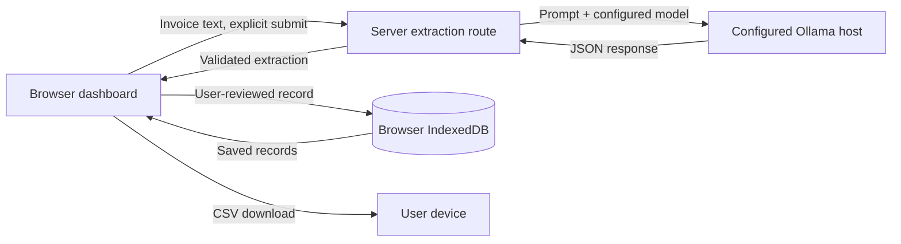

# InvoicePilot

Turn messy invoices into a reviewable expense ledger, with open-weight AI and a privacy-first local processing option.

InvoicePilot is a local-first MVP for freelancers, independent consultants, small-business owners, and small agencies. Paste invoice or receipt text, extract suggested fields with Ollama, review and correct every field, save expenses in your browser, and export the saved ledger as CSV.

> InvoicePilot is a productivity tool, not accounting, bookkeeping, tax, or compliance advice. Check extracted details against the original document.

## Product

- Live extraction and expense-category suggestions from your configured Ollama model. Sample text is sent to the model only when submitted and is never automatically saved.
- A review form for correcting vendor, reference, date, ISO currency, amounts, category, description, and model reasoning before saving.
- Five clearly marked fictional sample invoices covering freelance web development, graphic design, software, office supplies, and consulting. Loading or extracting a sample does not save it; saving always requires the user's approval.
- An explicit offline demo-fixture action for sample invoices. Demo values are pre-authored test data, clearly distinguished from live AI output, and are never silently substituted when model inference fails.
- IndexedDB persistence, vendor/reference search, category filtering, explicit delete confirmation, and CSV export of the actual saved records.
- Totals displayed separately for each currency. Incomplete fields stay missing; subtotal/tax/total inconsistencies receive a warning and are never auto-corrected.
- Responsive dashboard with model status, connection errors, confidence indicators, and local-storage disclosure.

### Screenshots

Add current desktop and mobile screenshots here when available, for example `docs/screenshots/dashboard.png` and `docs/screenshots/mobile.png`.

## Architecture



The UI has no direct model connection and never receives Ollama credentials. The server extraction route reads server-side environment settings and validates model output using Zod-backed schemas before returning it. During local development, Vite serves this route alongside the UI; the Next.js route adapter uses the same handler. Reviewed expenses are revalidated and stored only by the browser. CSV generation uses those saved records.

## Stack

- Vite 7, React 19, and TypeScript.
- Tailwind CSS 3 tooling with a small, custom CSS design system.
- Zod 3 for request and extraction validation.
- Ollama chat API for configurable local or explicitly configured remote inference.
- IndexedDB for browser-local persistence.
- A small CSV serializer with RFC-style quoting for commas, quotes, and line breaks.
- Vitest and fake-indexeddb for behavior-focused tests.

## Model

The default is **`gemma3:4b`**, selected as a practical instruct-capable open-weight model for local extraction on a reasonably capable laptop. It is the model sent in the Ollama request by default; configure `OLLAMA_MODEL` to select another compatible model. The dashboard displays the model returned by Ollama, not a hardcoded claim. Inference failures are shown, not replaced with fixture data.

Gemma 3 weights are distributed under Google's **Gemma Terms of Use**, not the Apache 2.0 license. Review the current [Gemma Terms of Use](https://ai.google.dev/gemma/terms) and [prohibited-use policy](https://ai.google.dev/gemma/prohibited_use_policy) before downloading or deploying. The terms include use restrictions, redistribution conditions, and obligations that may apply to products using Gemma. This repository does not redistribute model weights. Ollama distributes model packages separately; consult the selected model's Ollama library page and linked terms as well.

## Local setup

Requirements: Node.js 20 LTS (20.x), npm, and [Ollama](https://ollama.com/download) for live extraction. Avoid Node 24 for this repository in this environment because Next.js can crash with a native bus error in some dev containers.

1. Install JavaScript dependencies:

   ```sh
   npm install
   ```

2. Start Ollama and download the configured model:

   ```sh
   ollama serve
   ollama pull gemma3:4b
   ollama run gemma3:4b
   ```

   `ollama run` opens an interactive prompt; exit it when the model download is complete. Ollama must remain running while InvoicePilot extracts invoices. On systems where the Ollama desktop application starts the service automatically, `ollama serve` may report that port 11434 is already in use; keep the existing service.

3. Configure the optional server environment. Defaults are `http://127.0.0.1:11434` and `gemma3:4b`:

   ```sh
   cp .env.example .env.local
   ```

   ```dotenv
   OLLAMA_BASE_URL=http://127.0.0.1:11434
   OLLAMA_MODEL=gemma3:4b
   ```

   Restart the Vite server after changing `.env.local`. Keep this file server-side; do not expose these values through client-side environment variables or commit credentials. For a remote Ollama host, use an explicit trusted HTTPS endpoint and understand that invoice text will be transmitted to that host. Avoid exposing an unauthenticated Ollama service to the public internet.

4. Run the app and open [http://localhost:3000](http://localhost:3000):

   ```sh
   npm run dev
   ```

   Paste 20 or more characters or load a clearly labelled example, submit it, review the live model result, and save. Confirm the Ollama model is answering with `ollama list` and `ollama run gemma3:4b`; the app header also shows the configured model and processing host. If Ollama is unavailable, follow the actionable message in the app and retry.

### Configuration

| Variable | Default | Purpose |
| --- | --- | --- |
| `OLLAMA_BASE_URL` | `http://127.0.0.1:11434` | Server-side Ollama API base URL. |
| `OLLAMA_MODEL` | `gemma3:4b` | Model tag passed to `/api/chat`; pull it with `ollama pull`. |

The Vite server provides `GET /api/extract` (configured model and processing-location status) and `POST /api/extract` (live inference for the submitted invoice text) during development and preview. The static production build requires a compatible server to provide this API route.

## Tests and quality checks

```sh
npm test
npm run lint
npm run typecheck
npm run build
```

The test suite covers all five fictional invoice fixtures and their line-item/tax arithmetic, schema normalization and missing fields, invalid dates, amount mismatches, CSV export, IndexedDB create/edit/delete, ledger filtering, and Ollama request and error handling. Live model inference requires a running Ollama service and is not simulated by the automated unit tests.

## Privacy and data flow

- Invoice text is sent to the server-side extraction route only when the user submits it. The route forwards it to the `OLLAMA_BASE_URL` host and returns validated extraction fields; raw text is not stored in application persistence or logged by this code.
- With the default loopback URL and the app running on the same computer as Ollama, inference runs against that local Ollama service. If the URL points to another machine or service, invoice contents leave the computer and go to that configured host. Open weights alone do not guarantee privacy.
- Saved reviewed records remain in this browser's IndexedDB and are not sent back to the Next.js server. Browser storage is not encrypted secure document storage; other local users, browser extensions, device compromise, browser clearing, or storage eviction can expose or remove it. Do not use it as the only copy of important records.
- CSV export is generated in the browser and downloaded to the user's device.
- There are no accounts, analytics, payments, remote database, or hosted document storage in this MVP.
- The endpoint does not authenticate callers or rate-limit requests. Keep the development server private. A publicly deployed server with a configured Ollama host could be abused as an inference proxy; deployment needs authentication, abuse controls, and network restrictions. Do not publish a remote Ollama endpoint or put secrets in client-visible variables.

## Demo

For a live demonstration, run the app locally with Ollama and `gemma3:4b` downloaded. Choose one of the fictional invoices using **Load Sample Invoice**; its text is sent through the configured model only when you click **Extract invoice details**. Review or edit the result, then approve it to save. If the model is unavailable, choose **Run demo extraction (fixture, not AI)** to preview pre-authored values; the review panel labels demo mode, and the fixture is not saved unless you explicitly approve it. Refresh to verify browser persistence, search/filter the saved record, then export CSV. No sample expenses are preloaded.

The source documents are available as plain-text files in [samples/](./samples/).

A hosted UI is not included. If deployed later, clearly disclose the configured inference host: a hosted server cannot reach Ollama on a visitor's `127.0.0.1`, and hosted inference is not local inference on the visitor's device.

## Limitations and next steps

- Extraction quality depends on the chosen model, source text, and language. Always compare suggestions with the source document; no tax-compliance or accounting-accuracy guarantees are made.
- Input is pasted text only. PDF/image OCR, multi-page documents, authentication, encryption, cross-device sync, and production deployment hardening are out of scope.
- Local Ollama models and their hardware requirements vary. `gemma3:4b` is a default, not a guarantee that every machine has adequate memory or performance.
- Future work could add optional document OCR, richer currency conversion-free reports, encrypted backups, and authentication/rate-limiting before any public service deployment.

## License

The InvoicePilot application code is licensed under the [MIT License](LICENSE). The Gemma model and Ollama packages are governed by their own terms and are not covered by this repository license.